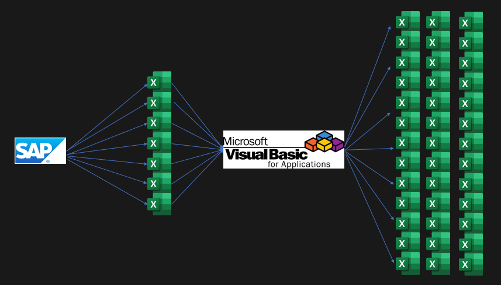
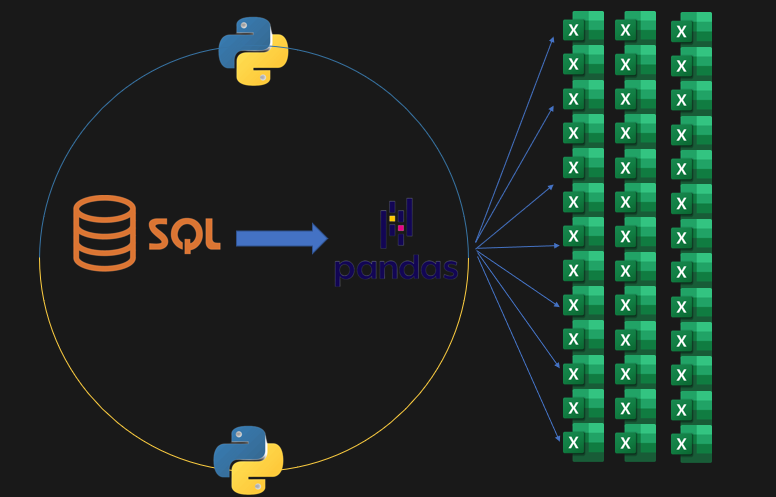

---
slides:
  title: Publicação Automatizada de Dados Abertos
revealjs:
  width: 1280
  height: 720
  margin: 0.02
---

<style>
/* ---------- Estilos reutilizáveis desta apresentação ---------- */

/* Slide 1: título e subtítulo */
.reveal .titulo { font-size: 2em; margin-bottom: 0.5em; }
.reveal .subtitulo {
  font-size: 0.7em;
  white-space: nowrap;
  letter-spacing: 0.05em;
  color: #6272a4;
  border-top: 2px solid #bd93f9;
  padding-top: 0.6em;
  display: inline-block;
}

/* Layout em duas colunas (título no topo, conteúdo dividido) */
.reveal .layout-topo { height: 680px; display: flex; flex-direction: column; }
.reveal .layout-topo h1 { margin: 0 0 0.2em 0; }
.reveal .duas-colunas { flex: 1; display: flex; align-items: center; gap: 60px; }
.reveal .duas-colunas > * { flex: 1; min-width: 0; margin: 0; }
.reveal .duas-colunas img { width: 100%; max-width: 100%; }
.reveal .duas-colunas p { text-align: left; font-size: 0.85em; line-height: 1.5; }

/* Citações */
.reveal .citacao { max-width: 1000px; margin: 0 auto; text-align: left; }
.reveal .citacao .aspas {
  font-family: Georgia, serif; font-size: 7em; line-height: 0.6;
  color: #bd93f9; height: 0.45em;
}
.reveal .citacao .texto { font-size: 1.5em; line-height: 1.4; font-style: italic; }
.reveal .citacao .autor { text-align: right; color: #ff79c6; font-size: 0.9em; margin-top: 1em; }

/* Tabela de indicadores */
.reveal table.indicadores { font-size: 0.75em; width: 100%; border-collapse: collapse; }
.reveal table.indicadores th {
  color: #bd93f9; font-size: 1.1em; text-align: left;
  border-bottom: 3px solid #bd93f9; padding: 0.4em 0.6em;
}
.reveal table.indicadores td {
  text-align: left; vertical-align: middle;
  border-bottom: 1px solid #44475a; padding: 0.5em 0.6em;
}
.reveal table.indicadores td:first-child { font-weight: bold; }
.reveal table.indicadores td:nth-child(2) { color: #6272a4; }
.reveal table.indicadores td:nth-child(3) { color: #50fa7b; }
</style>

<h1 class="titulo">Publicação Automatizada de Dados Abertos</h1>

<p class="subtitulo">De cinco dias de trabalho manual a seis horas de trabalho automatizado</p>

<!--s-->

<div class="layout-topo">
<h1>Contexto</h1>
<div class="duas-colunas">

<p>[...] tem como competência a <em>divulgação de dados, informações</em> e conhecimentos de criminalidade, violência e outros eventos e atuações de segurança pública [...]</p>
</div>
</div>

<!--s-->

<div class="citacao">
<div class="aspas">“</div>
<p class="texto">A verdadeira dificuldade não está tanto em desenvolver novas ideias, mas em escapar das antigas.</p>
<p class="autor">— John Maynard Keynes</p>
</div>

<!--s-->

#### Como era o trabalho manual?



<!--s-->

#### Como ficou a tarefa automatizada?



<!--s-->

#### Resultados e métricas

<table class="indicadores">
<thead>
<tr><th>Métricas</th><th>Antes</th><th>Depois</th></tr>
</thead>
<tbody>
<tr><td>Tempo de trabalho manual na rotina mensal</td><td>40h mensais</td><td>Cerca de 2h de conferência</td></tr>
<tr><td>Tempo total de execução</td><td>40h mensais manuais</td><td>Cerca de 6h de execução automatizada e 2h de conferência manual</td></tr>
<tr><td>Etapas manuais</td><td>14 etapas</td><td>Somente a conferência (com logs)</td></tr>
<tr><td>Risco de erros</td><td>Alto</td><td>Baixo</td></tr>
<tr><td>Transparência e governança</td><td>Baixa</td><td>Alta</td></tr>
</tbody>
</table>

<!--s-->

#### Governança e replicabilidade


<!--s-->

<div class="citacao">
<div class="aspas">“</div>
<p class="texto">A frase mais perigosa da língua é: “sempre fizemos assim”.</p>
<p class="autor">— Grace Hopper</p>
</div>

<!--s-->

```python
print("Obrigado!")
```


