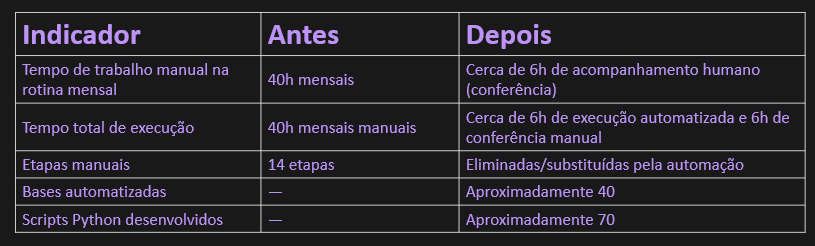
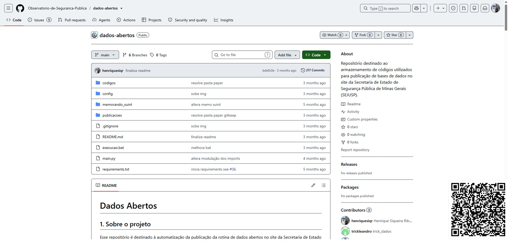

---
slides:
  title: Publicação Automatizada de Dados Abertos
---

# Publicação Automatizada de Dados Abertos

#### De cinco dias de trabalho manual a seis horas de trabalho automatizado

<!--s-->

# Contexto


[...] tem como competência a *divulgação de dados, informações* e conhecimentos de criminalidade, violência e outros eventos e atuações de segurança pública [...]

<!--s-->


“A verdadeira dificuldade não está tanto em desenvolver novas ideias, mas em escapar das antigas.”

<!--s-->

#### Como era o trabalho manual?


<!--s-->

#### Como ficou a tarefa automatizada?


<!--s-->



<!--s-->



<!--s-->

"A inovação não precisa começar com uma grande ideia. Pode começar com uma pergunta simples: por que continuamos fazendo isso dessa maneira?"

<!--s-->

```python
print("Obrigado!")
```
